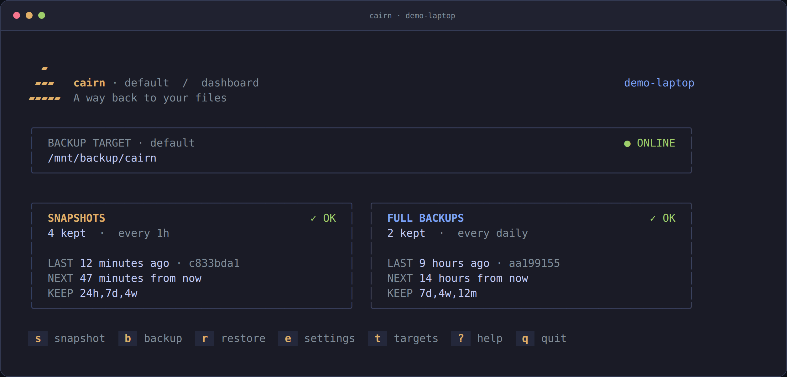
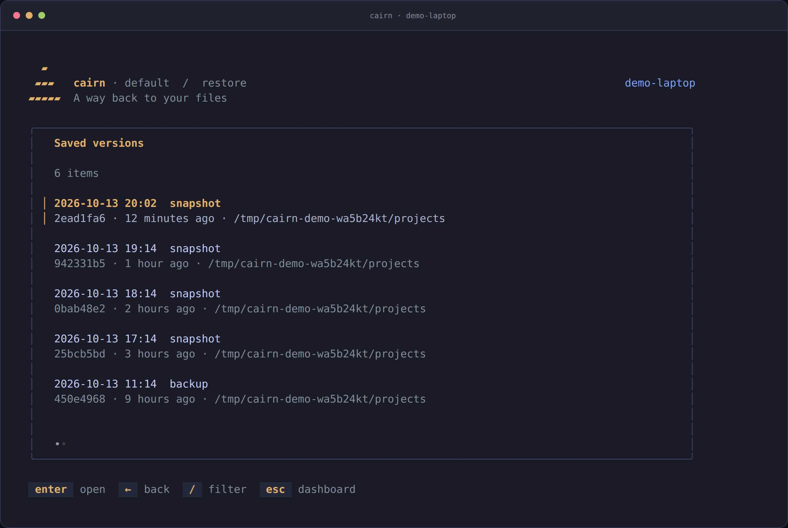
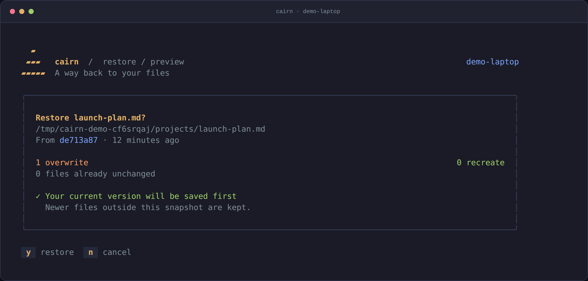
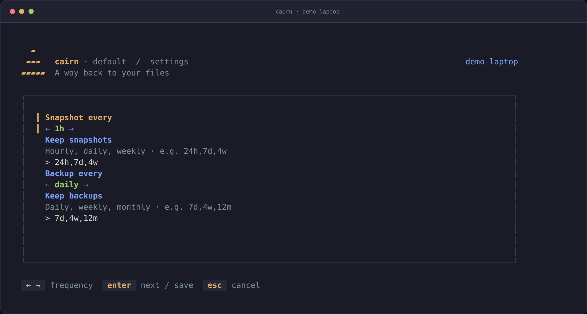
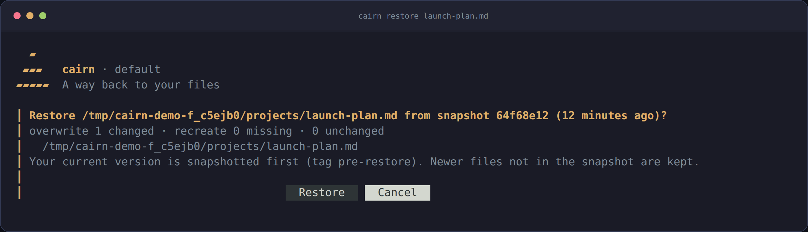
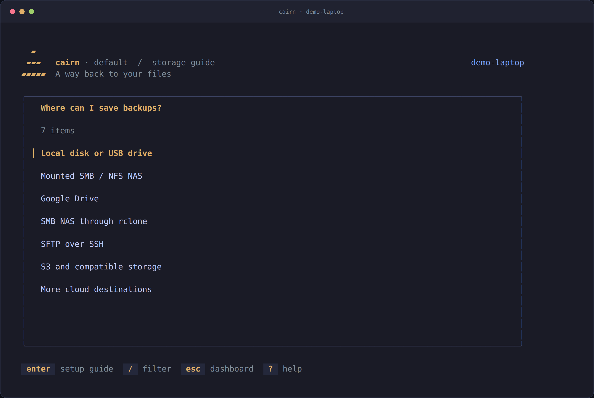
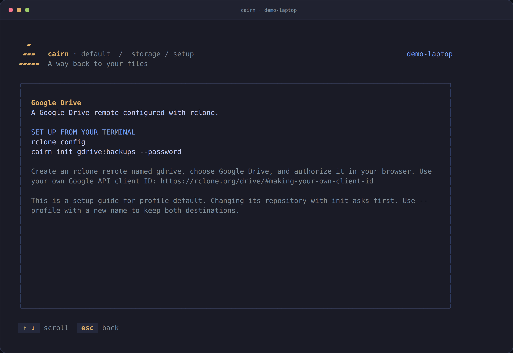

<div align="center">


**Snapshots. Backups. A way back.**

A small Linux backup tool with a sharp terminal UI. Powered by [restic](https://restic.net).

[](https://github.com/stefanbringuier/cairn/actions/workflows/ci.yml)
[](https://github.com/stefanbringuier/cairn/releases/latest)
[](go.mod)
[](LICENSE)

[Get started](#get-started) · [Usage guide](docs/usage.md) · [Contributing](CONTRIBUTING.md)

</div>



| ⏱ Set it and go | ↩ Restore with confidence | 🧳 Bring your setup back |
| :--- | :--- | :--- |
| Hourly snapshots, daily backups, automatic retention. | Preview changes. Save the current version. Undo a restore. | Recover your home and walk through reinstalling your packages. |

## Get started

**1. Install cairn.** Linux amd64 or arm64, detected automatically.

```sh
curl -fsSL https://raw.githubusercontent.com/stefanbringuier/cairn/main/scripts/install.sh | sh
```

**2. Choose your backup destination.** Mount your disk or share, then:

```sh
export PATH="$HOME/.local/bin:$PATH"
cairn init /mnt/backup/cairn
cairn
```

The installer verifies the release checksum and installs to `~/.local/bin`.
No sudo needed. [Installation options](docs/usage.md#install).

<details>
<summary>Prefer Go?</summary>

```sh
go install github.com/stefanbringuier/cairn/cmd/cairn@latest
```

</details>

**Linux amd64 + arm64.** Missing restic or rclone? cairn downloads pinned, checksum-verified copies. Systemd user timers automate runs; manual commands work without them.

## Find it. Preview it. Restore it.



<table>
<tr>
<td width="50%"></td>
<td width="50%"></td>
</tr>
<tr><td align="center"><b>See what changes before restoring.</b></td><td align="center"><b>Tune schedules from the terminal.</b></td></tr>
</table>

*Screens captured from the running TUI with a disposable demo repository.*

<details>
<summary><b>Prefer one command? Restore straight from the CLI.</b></summary>



</details>

<details>
<summary><b>Disks, NAS shares, or cloud drives? See the setup guides.</b></summary>




Press **t** for destination guides and **?** for the basics. These screens show
setup instructions; the demo repository is local.

</details>

## A few commands, plenty of control

| Do this | Run this |
| :--- | :--- |
| Restore a file from three days ago | `cairn restore ~/notes.md --at 3d` |
| Recover a folder somewhere else | `cairn restore ~/projects --to /tmp/recovered` |
| See a file's history | `cairn history ~/notes.md` |
| Back up right now | `cairn snapshot` / `cairn backup` |
| Take snapshots every 15 minutes | `cairn set snapshot.every 15m` |
| Rebuild on a replacement machine | `cairn rebuild` |

**One repository, two rhythms.** Snapshots cover your home. Full backups add `/etc`, keyrings, and package manifests. Shared files are deduplicated; caches and disposable environments are skipped.

**Your target, your choice.** Local disks and USB drives, mounted SMB/NFS shares, Google Drive, Dropbox and OneDrive through rclone, or SFTP, S3, B2, Azure, GCS and Swift. See [target setup](docs/usage.md#targets). **Password protection is off by default:** use `cairn init <target> --password` for cloud or shared storage and save the password elsewhere.

## Agent friendly

`cairn --skill` prints the complete command reference for AI agents. Read commands support `--json`; noninteractive actions that need confirmation require `-y`.

`cairn restore notes.txt` previews and asks first; add `-y` to proceed without
asking. The current version is saved either way. Try `cairn help restore`.

## Build & contribute

```sh
make setup        # install the pinned linter and enable Git hooks
make fmt          # gofumpt + goimports
make check        # format, lint, race tests, module tidiness, build
```

The executable lives in `cmd/cairn`; implementation and tests live in `internal/app`. PRs include design and specification updates in `docs/`. See [CONTRIBUTING.md](CONTRIBUTING.md), [AGENTS.md](AGENTS.md), and the [design guide](docs/design.md).

[Usage guide](docs/usage.md) · [Security](SECURITY.md) · [MIT](LICENSE) © Stefan Bringuier

<sub>Developed independently in my own time, with my own resources and without employer resources.</sub>
