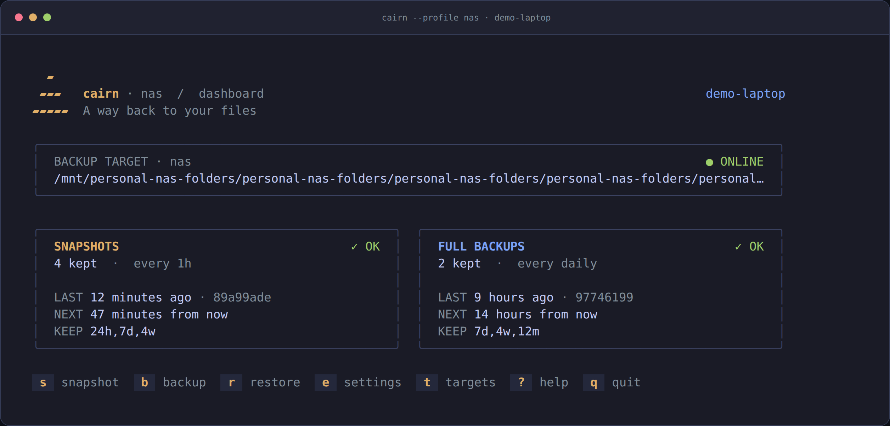
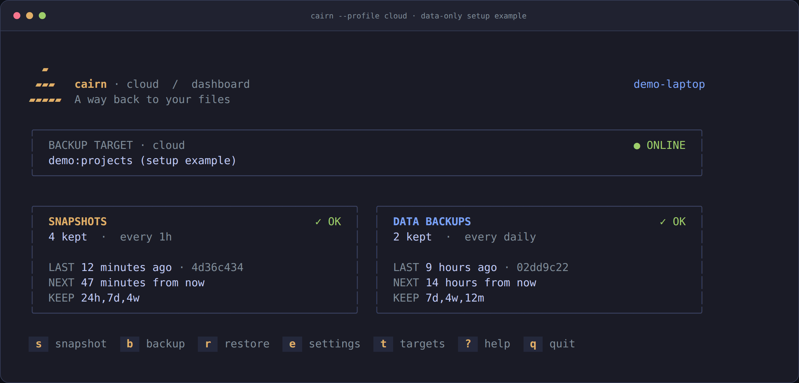

# Using cairn

[← README](../README.md)

## Install

Copy this command into your Linux terminal:

```sh
curl -fsSL https://raw.githubusercontent.com/stefanbringuier/cairn/main/scripts/install.sh | sh
```

The installer detects amd64 or arm64, downloads the latest release, checks its
SHA-256 checksum, and installs `cairn` to `~/.local/bin` without sudo. It needs
curl, tar, and the usual Linux command-line utilities.

Mount your backup disk or share, then start:

```sh
export PATH="$HOME/.local/bin:$PATH"
cairn init /mnt/backup/cairn
cairn
```

Use the actual mounted folder in place of `/mnt/backup`. See [targets](#targets)
for cloud destinations. Add the PATH line to your shell configuration if that
folder is not already on your PATH.

To choose a directory or version, download the script and pass the settings:

```sh
curl -fsSL https://raw.githubusercontent.com/stefanbringuier/cairn/main/scripts/install.sh -o /tmp/cairn-install.sh
CAIRN_INSTALL_DIR="$HOME/.local/bin" CAIRN_VERSION=v0.1.1 sh /tmp/cairn-install.sh
```

To update, rerun the first install command. It downloads the latest published
release and replaces the binary; your settings and backups stay in place.
Updates are manual. Release archives are also available for manual installation.

## Everyday use

| You want to… | Run |
|---|---|
| see what's going on | `cairn` (or `cairn status`) |
| get a file or folder back | `cairn restore ~/notes.md` |
| …as it was 3 days ago | `cairn restore ~/notes.md --at 3d` |
| …as a new copy | `cairn recover ~/proj --at 2026-10-01` |
| see every version | `cairn history ~/notes.md` |
| compare saved versions | `cairn diff <older> <newer> --path ~/notes.md` |
| back up right now | `cairn snapshot` or `cairn backup` |
| snapshot more often | `cairn set snapshot.every 15m` |
| keep more history | `cairn set backup.keep 14d,8w,24m,5y` |
| add a folder | `cairn set snapshot.paths +/data/projects` |
| skip something | `cairn set exclude +'*.iso'` |

**Restores preserve an undo copy:**
- cairn first shows what would change ("overwrite 3 changed · recreate 1 missing").
- It asks before going ahead; pass `-y` to skip the question.
- It saves existing destination contents before overwriting, including `--to`. An incomplete safety snapshot stops the restore. The undo command is printed before CLI replacement begins.
- Files newer than the snapshot that aren't in it are never deleted.

`cairn restore notes.txt` works from the folder containing that file, even if
the file has been deleted. Any extension works. `cairn restore notes.txt -y`
skips confirmation and still saves the current version first. Use `--to` to
choose an alternate destination and `--at` to choose an older version. For a
copy that must never replace existing work, use `cairn recover notes.txt`.
It returns a new copy in a private temporary directory; `--to` selects an exact
new filename or folder. Existing destinations are refused even if created
during the export, and failed exports publish no partial copy.

Safety snapshots include normally excluded content. Symbolic-link destinations
and local repository overlaps are refused. A safety snapshot does not freeze
ongoing edits: pause other writers before replacing current work. Files created
after a missing-destination check are protected by atomic no-replace publication.

For help, use `cairn help restore` or `cairn restore --help`. In the dashboard,
press `?` for the basics or `t` for destination setup guides. Choose a storage
type to see its setup commands; the guide leaves your current target in use.

## Several backup destinations

Use a named profile to keep a personal NAS and a separate cloud folder
scheduled together. These are setup examples; configure your mount and rclone
account first.

```sh
cairn --profile nas init /mnt/nas/cairn --password
cairn --profile cloud init gdrive:backups --data-only --path ~/Projects --password
cairn --profile cloud set snapshot.every 6h
cairn --profile cloud set backup.every daily
cairn profiles
cairn --profile nas status
cairn --profile cloud
```

Put `--profile NAME` **before the command**. It selects settings, passwords,
run state and the repository for every operation, including history, diff,
recover, restore and rebuild. Names use 1–48 lowercase letters, digits or
hyphens and begin and end with a letter or digit. Selection is never saved:
`cairn` and commands without the prefix always use `default`. Existing setups
become that default profile in place, keeping their settings, passwords, state
and timer names. There is no migration command.

```sh
cairn --profile cloud snapshot
cairn --profile cloud history ~/Projects/notes.md --json
cairn --profile cloud diff 3d --path ~/Projects/notes.md --json
cairn --profile cloud recover ~/Projects/notes.md --at 3d --json
cairn --profile cloud restore ~/Projects/notes.md --at 3d
```

Each profile needs a separate repository so retention cannot delete another
profile's history. Init refuses a repository used by another profile, including
local symlink aliases; remote aliases also need distinct underlying storage.
Re-running init preserves the selected profile's settings and password.
Changing its repository asks first (or accepts `-y`): future runs and retention
use the new destination, while old snapshots stay in the old one. Use a new
name to keep both destinations or use a different password. Invalid saved
configuration aborts instead of being replaced by defaults; a failed init
keeps the old configuration and removes only its newly generated unused password.

The NAS example uses machine scope; the cloud example uses data-only scope for
Projects. Rclone remote definitions and authentication remain shared in normal
rclone configuration (`RCLONE_CONFIG` or its XDG default), including when cloud
setup is invoked with a profile. Profiles keep separate restic passwords and
cairn settings/state; they do not create separate rclone accounts.

`cairn profiles --json` lists every configured profile with `name`, `target`, `backup_scope`,
and `snapshot`/`backup` objects containing `every`, `timer`, and `enabled`.
The enabled value reports actual timer state: true, false, or null if systemd
is unavailable. A configured frequency alone does not prove scheduling works.
Inspect logs with the profile's unit names:

```sh
journalctl --user -u cairn-nas-snapshot -u cairn-nas-backup -n 50
journalctl --user -u cairn-snapshot -u cairn-backup -n 50  # default profile
```

Named profile credentials live at
`$XDG_CONFIG_HOME/cairn/profiles/NAME/password` (normally
`~/.config/cairn/profiles/NAME/password`), alongside `config.json`.
Manifests, progress and pruning state live under
`$XDG_STATE_HOME/cairn/profiles/NAME`. Backup jobs across profiles share one
lock and run one at a time; downloaded dependencies stay shared. Timers carry
the XDG roots from init/settings so scheduled runs use the same configuration.
All configured local repositories are skipped by ordinary backups and protected
against restore replacement, as is the whole configuration root. Keep the
profile-qualified undo command printed by restore.



This capture uses a disposable repository. The NAS path and scheduling metadata
are fixtures, not a connected NAS or cloud account.

## Snapshots vs backups

| | **snapshot** | **backup** |
|---|---|---|
| for | getting files and folders back | rebuilding a machine after a disk dies |
| what | `$HOME` (plus any paths you add) | `$HOME`, `/etc`, `/usr/share/keyrings`, and lists of your installed packages (apt, snap, flatpak, brew, uv tools, pipx, cargo, npm -g, crontab) |
| default | every hour, keep `24h,7d,4w` | every day, keep `7d,4w,12m` |

Both kinds in a profile go to the **same repository**, so files they share are stored only once. Several machines can also share one repository: everything is tracked per host.

Regenerable stuff is skipped: `.venv`, `node_modules`, `__pycache__`, `.cache`, package-manager stores, trash, container storage, and anything marked with a `CACHEDIR.TAG`. Dotfiles and lockfiles (`pyproject.toml`, `uv.lock`, `package.json`, …) are always kept, so the environment can be regenerated.

### Back up data folders only

Choose data-only scope when the repository is for files rather than a machine
rebuild:

```sh
cairn init /mnt/backup/project-data --data-only --path ~/Projects --path ~/Documents
cairn backup
cairn set
```

Both jobs start with just those sources. Omit `--path` to use your home.
Data-only runs skip system-folder additions and installed-package lists;
old cairn manifests are excluded even when stored inside a source. Normal
cache exclusions, schedules, retention, and safe file recovery still apply.
The dashboard says **DATA BACKUPS**, and settings show `backup.scope`.
`cairn rebuild` refuses this mode; use `history`, `recover`, or `restore`.



Without `--data-only`, a new setup keeps the machine defaults above.
`--path` alone changes snapshot sources and also adds `/etc` and
`/usr/share/keyrings` to backup sources, with package manifests still included.
Editing `backup.paths` does not change scope. Reinitializing preserves scope,
frequencies, retention, and excludes; supplying paths replaces both source
lists according to that scope. To switch an existing setup, explicitly choose
the scope and supply the complete new source list:

```sh
cairn init /mnt/backup/project-data --data-only --path ~/Projects
cairn init /mnt/backup/cairn --data-only=false --path "$HOME"
```

Changing scope leaves old saved versions in the repository. New data-only
versions are tagged so a later machine rebuild ignores them.

## A new machine, the same setup

Install the OS, mount the same target, then:

```sh
cairn init /mnt/nas/cairn     # connects to the existing repository
cairn rebuild
```

For a named profile, use `cairn --profile nas init /mnt/nas/cairn` and
`cairn --profile nas rebuild`. The selected profile supplies the source repository
and recipe, but rebuild restores **the entire home**, including saved configuration
and systemd unit files for other profiles. Inspect `cairn profiles` and each
profile's settings and schedules afterward. Selection does not limit rebuild's
writes to that profile's files.

`rebuild` does three things:
1. It restores your old home into the new one. This works whatever the new disk, partitioning or filesystem.
2. It puts the old `/etc` in `~/.local/state/cairn/rebuild/etc` for reference.
3. It walks you through reinstalling your packages, one confirmed step at a time: apt sources and keys, then `apt`, `snap`, `flatpak`, `brew`, `uv`, `pipx`, `cargo`, `npm` and your crontab.

These steps are the only place cairn uses sudo, and you approve each one. Anything else that was in the backup is listed with the command to restore it.
Package lists always come from the selected machine backup, even when a newer
home snapshot omitted them. A failed package-list export stops installation;
current lists do not supplement the selected recipe.

## Targets

| Target | Setup / example |
|---|---|
| Local disk, USB drive, or another local mount | `cairn init /mnt/backup/cairn` |
| SMB/CIFS or NFS NAS mounted on Linux | Mount the share first, then `cairn init /mnt/nas/cairn` |
| Google Drive | Run `cairn cloud setup` to configure a `gdrive` remote, then `cairn init gdrive:backups --password` |
| SMB NAS through rclone, without a mount | Run `cairn cloud setup` to configure an `smb` remote named `nas`, then `cairn init nas:share/cairn --password` |
| Dropbox, OneDrive, and other writable rclone remotes | Run `cairn cloud setup` to configure a remote, then `cairn init remote:backups --password` |
| SFTP over SSH | `cairn init sftp:me@host:/srv/cairn --password` |
| S3 and compatible services, including MinIO and Wasabi | `cairn init s3:https://endpoint/bucket/cairn --password` |
| Backblaze B2, Azure Blob, Google Cloud Storage, OpenStack Swift, restic REST server | Use the corresponding `b2:`, `azure:`, `gs:`, `swift:`, or `rest:` [repository URL](https://restic.readthedocs.io/en/stable/030_preparing_a_new_repo.html) |

These are backup destinations. Mounted folders can also be sources: `cairn set snapshot.paths +/mnt/data`. To back up files stored remotely, mount or sync them locally first.

For a first cloud destination, even when rclone is not installed:

```sh
cairn cloud setup                     # create a remote named gdrive in rclone
cairn init gdrive:backups --password   # connect after authorization is complete
```

Setup opens rclone's configuration wizard. You choose the provider and complete
its authentication; these commands are setup examples, not connected accounts.
If rclone is missing, cairn downloads a pinned, checksum-checked copy to
`${XDG_DATA_HOME:-$HOME/.local/share}/cairn/bin/rclone`. `cairn cloud setup` runs
that copy directly, so you do not need to put its directory on PATH. Rclone
keeps its own configuration and honors its normal environment, including
`RCLONE_CONFIG`. To invoke the downloaded copy yourself:

```sh
"${XDG_DATA_HOME:-$HOME/.local/share}/cairn/bin/rclone" config
```

Cloud setup does not change cairn's current repository or timers. If `init`
cannot find or connect to the remote, it leaves the existing configuration,
timers, and repository password in place and removes any newly generated
password. Check the remote with `cairn cloud setup`, then retry `init`.

Google Drive uses rclone's browser authorization flow and currently requires your own Google API client ID; follow the [Drive setup guide](https://rclone.org/drive/#making-your-own-client-id). For direct SMB access, the first path segment is the share name, as described in the [rclone SMB guide](https://rclone.org/smb/).

Native cloud targets need their provider credentials. Scheduled runs execute under your systemd user manager, so make those credentials available there as well; shell-only exports do not automatically reach timers. Rclone remotes normally keep their configuration in your user config directory.

For older Linux kernels, restic documents a [CIFS compatibility issue](https://restic.readthedocs.io/en/stable/030_preparing_a_new_repo.html#local). Use a current kernel, an rclone SMB remote, or SFTP if your NAS supports it. For B2, restic recommends its S3-compatible API over the native `b2:` backend.

**Encryption is off by default.** Anyone who can read the target can read your files. That's fine for a drive you own. For cloud or shared targets, use `cairn init <target> --password`, and keep that password somewhere other than this machine.

If a local target is on the same disk as your home, cairn asks before using it. That catches an unmounted NAS mount point before it silently fills your system disk.

Sources use `--one-file-system`: mounted data is backed up when you explicitly
add its path, rather than by automatically crossing mounts beneath your home.

## Schedules and retention

- **Frequency** (`snapshot.every`, `backup.every`): `15m 30m 1h 6h 12h daily weekly off`.
  - Runs that were missed while the machine was off happen when it comes back.
  - Runs use low CPU and I/O priority.
  - Only one run happens at a time.
- **Retention** (`snapshot.keep`, `backup.keep`): a comma list of `<n>h <n>d <n>w <n>m <n>y`, meaning keep that many hourly, daily, weekly, monthly or yearly snapshots. A bare number keeps the last N, for example `8,24h,7d` for 15-minute snapshots. Old data is pruned about once a day.
- **When a run uses the target:** scheduled runs skip quietly when the target is offline, and the dashboard flags any job that's overdue.

Automatic schedules require systemd user timers and linger support. If that is
unavailable, `init` saves the configuration and warns; use `cairn snapshot`,
`cairn backup`, and `cairn restore` manually on other Linux setups.

## For AI agents

```sh
cairn --skill
```

That prints a self-contained skill file: every command and flag, the JSON shapes, exit codes and step-by-step recipes. Point your agent at it and it can drive cairn with no other docs.

Start with `history`, `diff`, and `recover`, using `--json` for structured
results. Diff compares saved snapshots, with optional `--path` filtering and
`--metadata`; it does not compare live files or interpret video contents.

```sh
cairn history dog.mp4 --json
cairn diff <older-snapshot> <newer-snapshot> --path dog.mp4 --json
cairn recover dog.mp4 --at <candidate-snapshot> --json
```

Diff returns one object with full `from`/`to` IDs, `changes: [{path, modifier}]`,
and counts in `summary`. Recover returns `{snapshot, source, destination}`.
Its destination can be inspected with ffprobe or another format-aware tool
while the live file stays untouched. Recover never needs `-y`.

The skill requires explicit approval before replacing current work. `-y`
skips a question; it does not supply approval. A skill cannot constrain an
unrestricted shell running as your user. See [agent safety](agent-safety.md)
for separate-user permissions and trusted-executor deployment choices.

## How it works

```text
cairn init ─▶ ~/.config/cairn/config.json
           ─▶ ~/.config/systemd/user/cairn-{snapshot,backup}.{service,timer}
timer ─▶ cairn snapshot|backup ─▶ restic backup --json … ─▶ restic forget [--prune]
cairn restore ─▶ restic restore --dry-run (preview) ─▶ restic backup (safety) ─▶ restic restore
```

The repository is plain restic, so you can always use restic directly:

```sh
RESTIC_REPOSITORY=/mnt/nas/cairn restic --insecure-no-password snapshots
```

## Uninstall

```sh
cairn set snapshot.every off && cairn set backup.every off
rm -f ~/.config/systemd/user/cairn-* ~/.local/bin/cairn && rm -rf ~/.config/cairn ~/.local/state/cairn ~/.local/share/cairn
```

Your backups stay in the target until you delete them.
